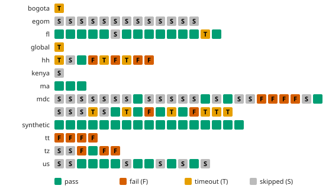

# gaiaCatalog  

gaiaCatalog contains all the materials to build the gaiaCatalog containers for use in the [OHDSI/GIS toolchain](https://github.com/OHDSI/GIS) as a part of the [Information on Observational Health Data Sciences and Informatics (OHDSI)](http://www.ohdsi.org/ "OHDSI Website") organization. 

> **Status:** under active development

---

## Contents

- [Introduction](#introduction)
- [Dataset Structure](#dataset-structure)
- [Docker Container Builds](#docker-container-builds)
- [Support](#support)
- [Developer Guidelines](#developer-guidelines)

---

## Introduction

This repository has two principal components:

- a catalog comprised of metadata descriptions for GIS datasets
- two docker build specifications to provide a SOLR index of the catalog entries and a user interface to the index.

**NOTE**: This is not a standalone tool. Please see the [gaiaDB repository](https://github.com/OHDSI/gaiaDB) for integration into the gaiaDB project and the  [gaiaDocker repository](https://github.com/OHDSI/gaiaDocker) for the integration into a browser-based exploration and ingestion tool.

This repository contains:  

```
+-- datastore
    # metadata descriptions used by gaiaDB and gaiaDocker  
    +-- data
        # collection of catalog entries (see below for details)
    +-- collections
        # a description of the OHDSI data collection
+-- docker  
    # The config files for docker container builds used by gaiaDocker
    +-- repository 
        # a flask app to provide a user interface  
    +-- solr
        # the solr index of the catalog entries  
+-- examples  
    # template files for the catalog entries  
```

Note that there is more content under development.

### Dependencies  

- Linux, Mac, or Windows  
- Docker 1.27.0+  
- Git  

## Dataset Structure

Each dataset under `/datastore/data` follows this layout:

```
/datastore/data/{table_id}/
  meta_json-ld_{table_id}.json       ← JSON-LD metadata (dataset + variables)
  meta_etl_{table_id}.json           ← ETL configuration (geometry, EPSG, fields)
  meta_dcat_{table_id}.json          ← DCAT catalog metadata
  etl/
    {table_id}_osgeo.sh              ← Step 1: download + ogr2ogr load
    {table_id}_postgis.sh            ← Step 2: geometry cleanup + local projection
    {table_id}_osgeo_derivative.sh   ← (publishing) create derived osgeo outputs
    {table_id}_postgis_derivative.sh ← (publishing) pg_dump + tarball for download
  download/                          ← created at runtime by _osgeo.sh
  derived/                           ← created at runtime by derivative scripts
```


## Docker Container Builds  

The build context for both images is the root directory of this repository.

```shell
docker build -t gaia-catalog -f ./docker/repository/Dockerfile . 
docker build -t gaia-solr -f ./docker/solr/Dockerfile .
```

Or use the `docker compose` on the [gaiaDocker repository](https://github.com/OHDSI/gaiaDocker).

## Support

Please use the [GitHub issue tracker](https://github.com/OHDSI/gaiaCatalog/issues) for bugs and feature requests.

## Developer Guidelines

- Open an issue before starting significant work
- Create a feature branch and submit a Pull Request when ready
- PRs require review before merge to `main`
## Ingest status

A scheduled check ingests every source in `datastore/data` into a fresh
[gaiaDB](https://github.com/OHDSI/gaiaDB) container using
`backbone.ingest_datasource` and reports whether it succeeded. To run it locally
(requires Docker and the `ohdsi/gaia-db` image):

```
python architecture/masterControl.py validate_ingest --data_dir ./datastore/data \
    --results_file ./ingest_results.json --readme ./README.md
```

Use `--source <name>` (repeatable) to check selected sources only. The table
below is rewritten by that command; do not edit it by hand.

<!-- ingest-report:start -->
51 of 80 sources ingest into gaiaDB (fail: 17, timeout: 12, deferred, needs credentials or local data: 41, not ingestible: 3).

Last run: 2026-11-17 16:20 UTC using `ohdsi/gaia-db:main` sha256:03ac6ba13d19



| Status | Step | Cause | Count | Sources |
|--------|------|-------|-------|---------|
| FAIL | postgis | The download returned an error page, so the table was never created | 9 | hh_glaciares_osm, hh_red_vial_osm, hh_rios_arroyos_osm, hh_rutas_pie_osm, tt_ferry_routes, tt_populated_places, tt_regions, tt_roads, tz_regions_osm |
| FAIL | dependency | dependency directory missing: [id] | 5 | mdc_2021_nlcd_impervious_surfaces, mdc_2021_nlcd_land_cover, mdc_2021_nlcd_tcc_v2023_5, mdc_2021_nlcd_tcc_v4, tz_2022_nbs_magu_district |
| FAIL | metadata_load | Metadata load failed: invalid input syntax for type numeric: "..." | 2 | mdc_county_park_boundaries, mdc_municipal_park_boundaries |
| FAIL | postgis | postgis script failed: script exited with status 1; script output: LINE 2: SELECT * INTO [id] FROM points; / ^ / ERROR: relation "..." does not exist; small ... | 1 | tz_populated_places_osm |
| TIMEOUT | ingest | no result after 1800s | 12 | bogota_2019_estratos_manzana_dane, fl_2026_flma, global_pm25_concentration_1998_2016, hh_2023_bofedales_inaigem, hh_lagunas_ana, hh_rios_ana, mdc_2026_flma, mdc_community_health_centers, mdc_holc_redlining, mdc_sexual_predators, mdc_streets, mdc_water_polygons |
| SKIPPED | deferred | [id]: data is supplied manually (no download step) and [id]/download is not present | 27 | egom_2012_viirs_vnp46a4, egom_2013_viirs_vnp46a4, egom_2014_viirs_vnp46a4, egom_2015_viirs_vnp46a4, egom_2016_viirs_vnp46a4, egom_2017_viirs_vnp46a4, egom_2018_viirs_vnp46a4, egom_2019_viirs_vnp46a4, egom_2020_viirs_vnp46a4, egom_2021_viirs_vnp46a4, egom_2022_viirs_vnp46a4, egom_2023_viirs_vnp46a4, egom_2024_viirs_vnp46a4, hh_dem_copernicus, kenya_ppd_survey_2014, mdc_2012_viirs_vnp46a4, mdc_2013_viirs_vnp46a4, mdc_2014_viirs_vnp46a4, mdc_2015_viirs_vnp46a4, mdc_2016_viirs_vnp46a4, mdc_2017_viirs_vnp46a4, mdc_2018_viirs_vnp46a4, mdc_2019_viirs_vnp46a4, mdc_2020_viirs_vnp46a4, mdc_2023_viirs_vnp46a4, mdc_5000_addresses_normalized, tz_1984_copernicus_avg_temp |
| SKIPPED | deferred | ETL scripts use credentials (CENSUS_API_KEY) | 11 | fl_2021_acs_5yr_tract_fsr, mdc_2019_acs_5yr_tract_dvmt, mdc_2020_2024_acs_5yr_trends_tract_dvmt, mdc_2020_acs_5yr_tract_dvmt, mdc_2021_acs_5yr_tract_dvmt, mdc_2022_acs_5yr_tract_dvmt, mdc_2023_acs_5yr_tract_dvmt, mdc_2024_acs_5yr_tract_dvmt, us_2020_census_county_fips, us_2022_annual_aqi_by_county, us_2023_annual_aqi_by_county |
| SKIPPED | metadata | no meta_etl_[id].json; not an ingestible source | 3 | mdc_2013_2022_lst_30m, mdc_2021_hylo, tz_2022_nbs |
| SKIPPED | deferred | ETL scripts use credentials (CDC_APP_TOKEN) | 2 | us_2014_2019_monthly_pm25_by_county_cdc, us_2014_2019_monthly_pm25_by_tract_cdc |
| SKIPPED | deferred | [id]: ArcGIS endpoint now returns 'Token Required' (HTTP 200 with an error body) | 1 | us_nuclear_power_plants |

<details><summary>51 sources pass</summary>

fl_2018_svi_tract (fields not in table:), fl_2019_tl_tract, fl_2020_svi_county, fl_2020_svi_tract, fl_2020_tl_tract, fl_2021_tl_tract, fl_2022_svi_tract, fl_2022_tl_cousub, fl_2022_tl_tract, fl_2023_tl_tract, fl_2024_tl_tract, fl_2025_tl_tract, fl_superfund_waste_cleanup_sites, hh_dem_srtm, ma_2018_svi_tract, ma_2020_svi_tract, ma_2022_svi_tract, mdc_2018_svi_tract (fields not in table:), mdc_2020_svi_tract, mdc_2020_zcta, mdc_2022_svi_tract, mdc_brownfield_site, mdc_cooling_stations, mdc_federally_qualified_health_centers, mdc_hospitals, synthetic_county_ses, synthetic_monitors_20, synthetic_monitors_200, synthetic_monitors_200_voronoi, synthetic_monitors_20_voronoi, synthetic_monitors_60, synthetic_monitors_60_voronoi, synthetic_raster_annual, synthetic_raster_landcover, synthetic_raster_surface_100m, synthetic_raster_surface_10km, synthetic_raster_surface_1km, synthetic_road_proximity, synthetic_surface_100m, synthetic_surface_10km, synthetic_surface_1km, synthetic_tract_ses, tz_magu_dem_srtm, us_2018_svi_county (fields not in table: , stcnty), us_2019_county_tl, us_2019_prisecroads_tl, us_2019_tract_tl, us_2020_county_tl, us_2020_zcta, us_2022_county_tl, us_2023_county_tl

</details>
<!-- ingest-report:end -->
